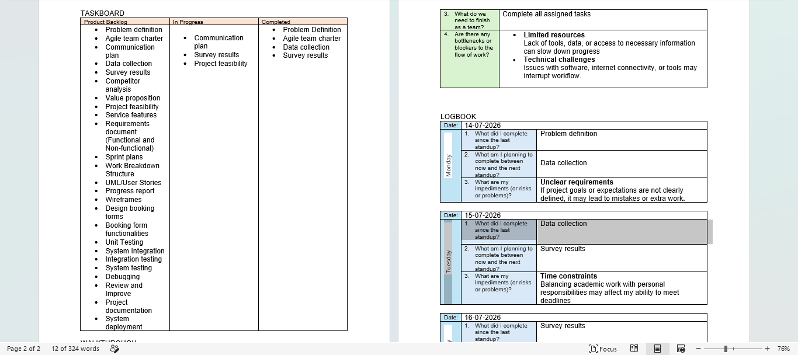

# Agile Logbook

## 1. Project Information

**Project:** Laundry Pickup Pro  
**Team:** Group 3D  
**My Role:** UI/UX Designer

## 2. Agile Activity Log

The team worked through multiple sprints, using a taskboard to organise activities into Product Backlog, In Progress, and Completed.

### 14 July 2026 – Monday

- **What I completed since the last stand-up:** Problem definition.
- **What I planned to complete next:** Data collection.
- **Impediments or risks:** Unclear requirements. If project goals or expectations are not clearly defined, this may lead to mistakes or extra work.

### 15 July 2026 – Tuesday

- **What I completed since the last stand-up:** Data collection.
- **What I planned to complete next:** Survey results.
- **Impediments or risks:** Time constraints. Balancing academic work with personal responsibilities may affect my ability to meet deadlines.

### 16 July 2026 – Wednesday

- **What I completed since the last stand-up:** Survey results.
- **What I planned to complete next:** Communication plan.
- **Impediments or risks:** Getting accurate data to avoid data redundancy.

## 3. Taskboard Evidence

The team's taskboard was divided into three columns:

- **Product Backlog:** Activities and requirements still to be addressed.
- **In Progress:** Communication plan, survey results and project feasibility.
- **Completed:** Problem definition, Agile team charter, data collection and survey results.

The taskboard helped the team see which activities were completed, which were being worked on, and which still needed attention.

## 4. Team Walkthrough

The team walkthrough focused on:

- Clarifying the next steps.
- Setting deadlines.
- Improving communication.
- Addressing risks early.

The walkthrough also checked whether anyone was working on activities that were not represented on the taskboard. The recorded response was no.

## 5. Challenges and Impediments

The logbook recorded the following challenges:

| Challenge | Impact |
|---|---|
| Unclear requirements | May result in mistakes or additional work. |
| Time constraints | Academic and personal responsibilities may affect deadlines. |
| Data accuracy | Inaccurate information may lead to data redundancy. |

## 6. Reflection

The Agile process helped me understand the importance of tracking work regularly and communicating progress with the team. The taskboard provided a visual way to identify completed activities, work in progress, and outstanding tasks.

The daily logbook entries also helped identify challenges early. For example, unclear requirements could lead to unnecessary work, while time constraints could affect the team's ability to meet deadlines.

As the UI/UX Designer, I learned that good teamwork and communication are important because design activities depend on understanding the project requirements and coordinating with other team members.

The team used multiple sprints, allowing work to be organised into smaller stages. This made it easier to monitor progress and identify what needed attention next.

## Agile Process Evidence

### 11. Agile Taskboard

The taskboard shows how the team organised project activities into Product Backlog, In Progress, and Completed columns. It also records the team's walkthrough and discussion of next steps.

### 12. Agile Logbook

These logbook entries record daily progress from 14 to 16 July 2026, including completed activities, planned activities, and impediments.

