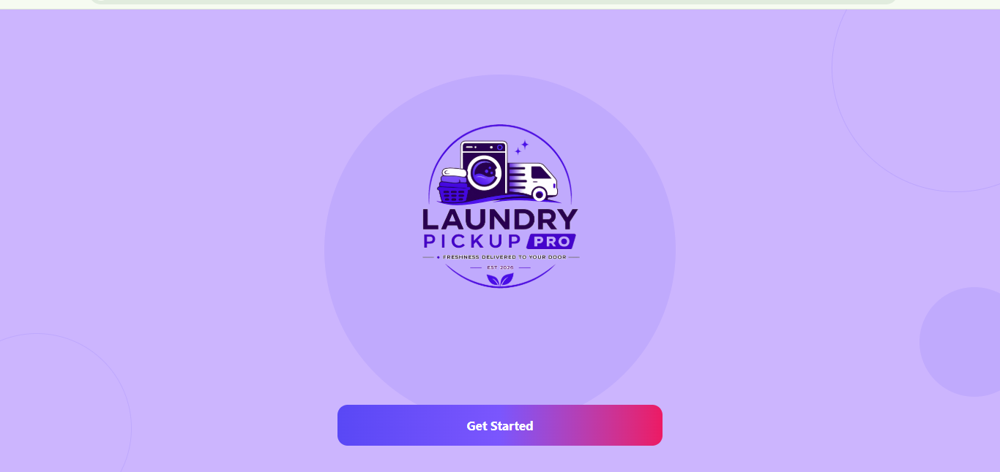
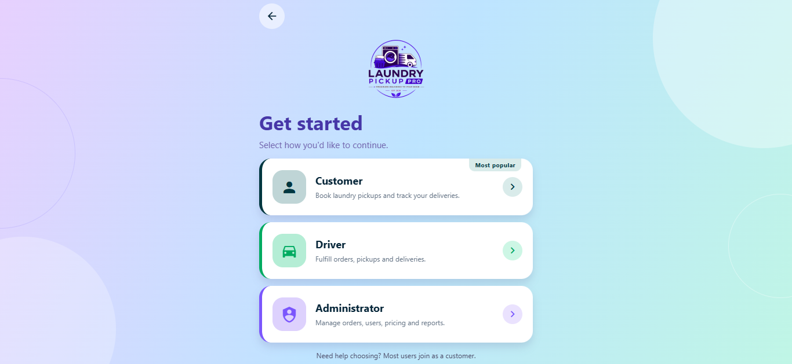
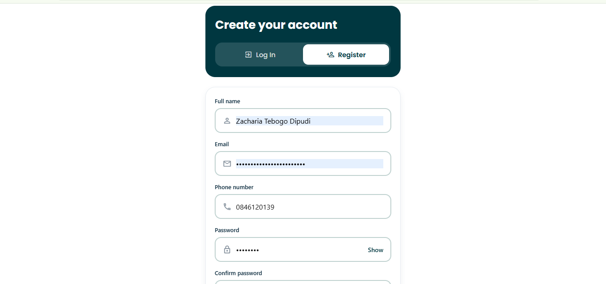
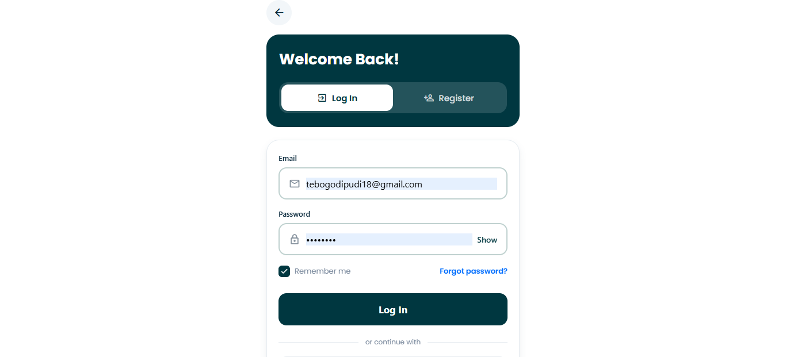
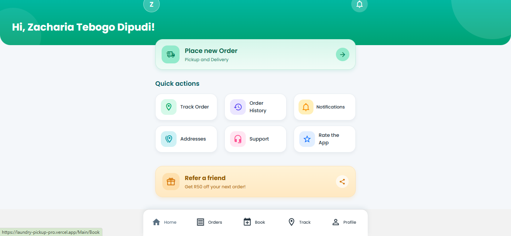
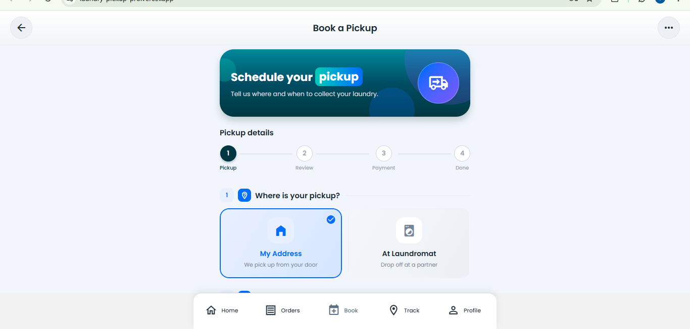
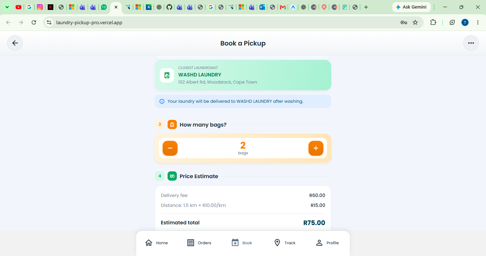
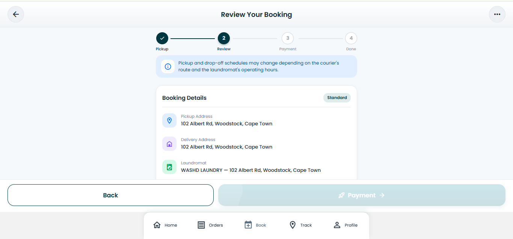
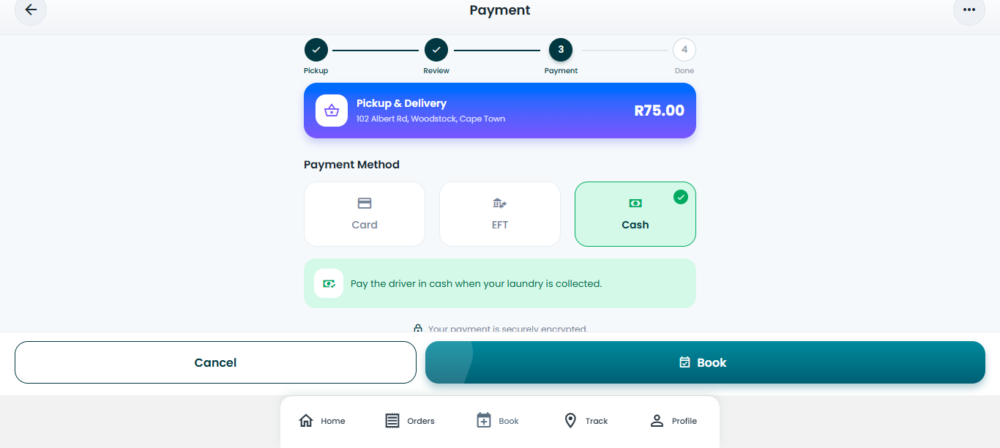
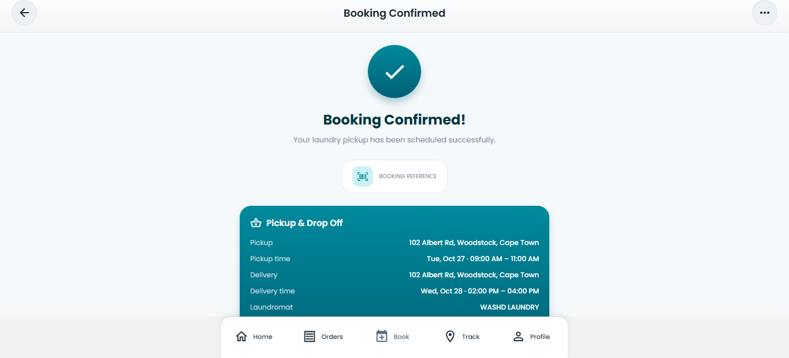

# Laundry Pickup Pro — Portfolio Evidence

This folder contains visual evidence from the Laundry Pickup Pro application, developed to support the Agile project management e-portfolio for PRP372S.

The screenshots document the customer journey, from opening the application to completing a laundry pickup booking. Each item includes a description of the interface and its relevance to the project.

## Evidence Index

| Filename | Evidence | Assessment relevance |
|---|---|---|
| `01-welcome-screen.png` | Welcome screen and Get Started button | User Stories and Tasks; UI/UX design |
| `02-role-selection.png` | Customer, Driver, and Administrator options | User Stories and Tasks; user roles |
| `03-registration-screen.png` | Customer account registration | Product Backlog; account creation |
| `04-login-screen.png` | Customer login interface | Product Backlog; account access |
| `05-customer-dashboard.png` | Customer dashboard and quick actions | User Stories and Tasks; navigation |
| `06-pickup-scheduling.png` | Pickup location selection and booking steps | User Stories and Tasks; booking |
| `07-price-estimate.png` | Bag quantity and estimated price | Product Backlog; price transparency |
| `08-booking-review.png` | Booking details and price breakdown | User Stories and Tasks; review process |
| `09-payment-method.png` | Card, EFT, and cash options | Product Backlog; payment selection |
| `10-booking-confirmation.png` | Successful booking confirmation | User Stories and Tasks; user feedback |
| `11-order-tracking.png` | To be added after capturing the Track Order screen | Order tracking |

## Personal Contribution

My assigned role in the team charter was UI/UX Designer. These screenshots can help demonstrate my understanding of interface layout, navigation, visual hierarchy, and the customer booking journey.

The screenshots show the interfaces presented by the application. They do not independently prove which parts I personally implemented, how the team planned its sprints, or whether every feature works correctly.

## Reflection

Reviewing the application screens helps me understand how interface design supports a customer's journey. The booking process presents information in stages, allowing users to select pickup details, review the estimated cost, choose a payment method, and view a confirmation.

I learned the importance of clear navigation, understandable labels, visible costs, and feedback after a user action. I can use these observations to evaluate the design and identify areas for improvement. I will also connect this visual evidence to the relevant user stories and genuine project planning records in the rest of my portfolio.

## Privacy and Accuracy

Before publishing screenshots, remove or obscure personal email addresses, phone numbers, passwords, and private residential addresses. Only describe features as working when they have been tested.

## Visual Evidence from the Application

### 1. Welcome Screen

The welcome screen introduces Laundry Pickup Pro and provides a clear starting point for users.

### 2. User Role Selection

This screen allows users to choose between Customer, Driver, and Administrator.

### 3. Customer Registration

This screen provides a form for creating a customer account.

### 4. Customer Login

This screen provides access to existing customer accounts.

### 5. Customer Dashboard

The dashboard provides access to ordering, tracking, order history, notifications, and other customer actions.

### 6. Pickup Scheduling

Customers can select a pickup option and proceed through the booking stages.

### 7. Price Estimate

The booking interface displays the bag quantity and an estimated service cost.

### 8. Booking Review

Customers can review their booking details and the price breakdown before continuing.

### 9. Payment Method

The interface presents Card, EFT, and Cash as payment options.

### 10. Booking Confirmation

The confirmation screen displays the result of the booking process and summarises the arrangements.

