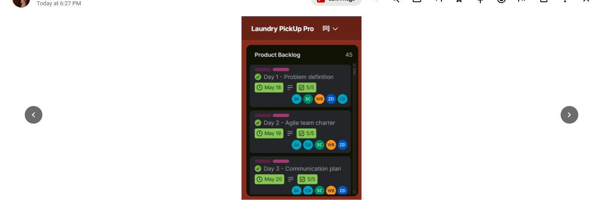

# Product Backlog

## 1. Project Overview

**Project:** Laundry Pickup Pro  
**Team:** Group 3D  
**My Role:** UI/UX Designer

The product backlog is a prioritised list of user needs, features, and improvements for Laundry Pickup Pro. The application aims to help customers arrange laundry pickup and delivery through a clear and convenient digital experience.

The backlog below is a working proposal based on the application screens and user journeys documented in this portfolio. The priorities and status should be reviewed with the project team.

# Product Backlog

## 1. Project Overview

**Project:** Laundry Pickup Pro  
**Team:** Group 3D

The Product Backlog contains the tasks and activities recorded by the team for the Laundry Pickup Pro project. The team's Trello board displays a Product Backlog with 45 items.

The backlog covers project planning, research, requirements, design, prototyping, testing, documentation and deployment activities.

## 2. Product Backlog Items

The following items are visible in the team's Product Backlog screenshots.

| No. | Backlog Item | Date | Checklist Progress |
|---|---|---|---|
| 1 | Problem definition | May 18 | 5/5 |
| 2 | Agile team charter | May 19 | 5/5 |
| 3 | Communication plan | May 20 | 5/5 |
| 4 | Conduct user research | May 21 | 5/5 |
| 5 | Summary of findings | May 22 | 5/5 |
| 6 | Competitor analysis | May 25 | 5/5 |
| 7 | Project feasibility | May 26 | 5/5 |
| 8 | Project risk analysis | May 27 | 5/5 |
| 9 | Marketing strategy | May 28 | 5/5 |
| 10 | Value proposition | May 29 | 5/5 |
| 11 | Requirements document (Functional and Non-functional) | May 30 | 5/5 |
| 12 | Work Breakdown Structure (WBS) | June 1 | 9/9 |
| 13 | Sprint Plans | June 2 | 5/5 |
| 14 | User Stories | June 4 | 5/5 |
| 15 | UML Diagrams | June 8 | 5/5 |
| 16 | Progress Report | June 9 | 5/5 |
| 17 | PowerPoint Presentation Slides | July 14 | 5/5 |
| 18 | Business Overview and Problem Statement | July 15 | 5/5 |
| 19 | Presentation delivery | July 16 | 5/5 |
| 20 | Presentation Update | July 17 | 5/5 |
| 21 | Trello Board Setup and Management | July 21 | 5/5 |
| 22 | Application features | July 24 | 5/5 |
| 23 | Low Fidelity Wireframes | July 28 | 5/5 |
| 24 | High Fidelity User Interface Design (UI/UX) | Not fully visible | Not fully visible |
| 25 | Interactive Figma Prototype | July 31 | 5/5 |
| 26 | Prototype Testing | August 1 | 5/5 |
| 27 | Prototype Demonstration | August 2 | 5/5 |

## 5. UI/UX Designer's Contribution

As the UI/UX Designer, the most relevant backlog activities to my role include application features, low-fidelity wireframes, high-fidelity user interface design, interactive Figma prototyping, prototype testing and prototype demonstration.

These activities relate to planning the user experience, designing application screens and reviewing the prototype before further development.

## 6. Reflection

Reviewing the Product Backlog helped me understand how a project can be organised into smaller activities, from initial planning and research to interface design, prototyping and testing.

I also learned that the backlog is not limited to software development tasks. It includes research, requirements, documentation, presentations and other activities needed to move the project forward.

From my UI/UX perspective, the wireframe, interface design and Figma prototype activities are particularly important because they help turn application requirements into a design that users can understand and navigate.

The Trello board made the team's activities visible and provided a way to monitor task dates, assignments and checklist progress.

## 3. Product Backlog Evidence

The following screenshots show the team's actual Product Backlog board.

### Evidence 1: Initial Planning and Research

Shows problem definition, Agile team charter, communication plan, user research, summary of findings and competitor analysis.

### Evidence 2: Feasibility and Project Analysis

Shows project feasibility, project risk analysis and marketing strategy.

### Evidence 3: Requirements and Project Structure

Shows the value proposition, functional and non-functional requirements document, and Work Breakdown Structure.

### Evidence 4: Sprint Planning and Modelling

Shows sprint plans, user stories and UML diagrams.

### Evidence 5: Progress and Presentation Preparation

Shows the progress report and PowerPoint presentation slides.

### Evidence 6: Presentation and Board Management

Shows presentation delivery, presentation updates, and Trello board setup and management.

### Evidence 7: Application Planning and Wireframes

Shows application features, low-fidelity wireframes and part of the high-fidelity UI/UX design task.

### Evidence 8: Prototype Development and Testing

Shows the interactive Figma prototype, prototype testing and prototype demonstration.

