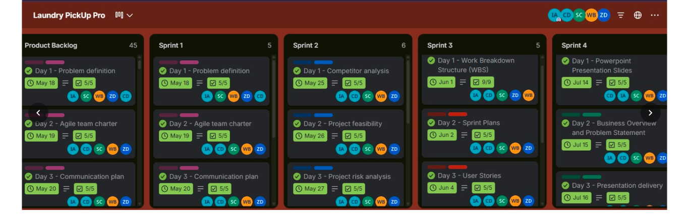
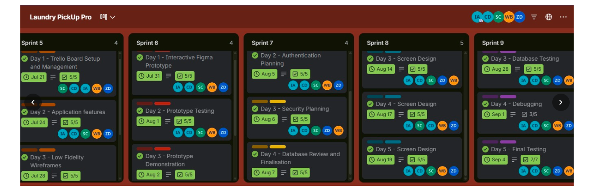
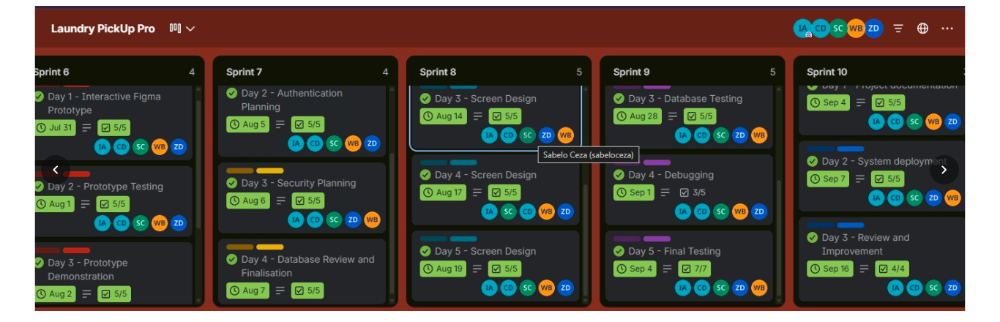

# Sprint Backlog

## 1. Sprint Overview

**Project:** Laundry Pickup Pro  
**Team:** Group 3D  
**My Role:** UI/UX Designer  
**Sprint Goal:** Review and improve the customer-facing interface for the main laundry booking journey.

This sprint backlog outlines proposed tasks for improving and reviewing the customer interface. The team should confirm the sprint dates, selected work, assignments, and completion status against its actual sprint plan.

## 2. Sprint Backlog and Sprint Activities

The Laundry Pickup Pro team used a Trello taskboard to organise and monitor project activities across 10 sprints. Each sprint contained specific tasks with assigned team members, dates, and checklist progress.

### Sprint 1 – Initial Project Planning

| Task | Date | Checklist |
|---|---|---|
| Day 1 – Problem definition | May 18 | 5/5 |
| Day 2 – Agile team charter | May 19 | 5/5 |
| Day 3 – Communication plan | May 20 | 5/5 |

### Sprint 2 – Research and Feasibility

| Task | Date | Checklist |
|---|---|---|
| Day 1 – Competitor analysis | May 25 | 5/5 |
| Day 2 – Project feasibility | May 26 | 5/5 |
| Day 3 – Project risk analysis | May 27 | 5/5 |

### Sprint 3 – Project Structure and Planning

| Task | Date | Checklist |
|---|---|---|
| Day 1 – Work Breakdown Structure (WBS) | June 1 | 9/9 |
| Day 2 – Sprint Plans | June 2 | 5/5 |
| Day 3 – User Stories | June 4 | 5/5 |

### Sprint 4 – Project Presentation

| Task | Date | Checklist |
|---|---|---|
| Day 1 – PowerPoint Presentation Slides | July 14 | 5/5 |
| Day 2 – Business Overview and Problem Statement | July 15 | 5/5 |
| Day 3 – Presentation delivery | July 16 | 5/5 |

### Sprint 5 – Project Setup and Application Planning

| Task | Date | Checklist |
|---|---|---|
| Day 1 – Trello Board Setup and Management | July 21 | 5/5 |
| Day 2 – Application features | July 24 | 5/5 |
| Day 3 – Low Fidelity Wireframes | July 28 | 5/5 |

### Sprint 6 – Prototype Development

| Task | Date | Checklist |
|---|---|---|
| Day 1 – Interactive Figma Prototype | July 31 | 5/5 |
| Day 2 – Prototype Testing | August 1 | 5/5 |
| Day 3 – Prototype Demonstration | August 2 | 5/5 |

### Sprint 7 – Authentication and Security Planning

| Task | Date | Checklist |
|---|---|---|
| Day 2 – Authentication Planning | August 5 | 5/5 |
| Day 3 – Security Planning | August 6 | 5/5 |
| Day 4 – Database Review and Finalisation | August 7 | 5/5 |

### Sprint 8 – Screen Design

| Task | Date | Checklist |
|---|---|---|
| Day 3 – Screen Design | August 14 | 5/5 |
| Day 4 – Screen Design | August 17 | 5/5 |
| Day 5 – Screen Design | August 19 | 5/5 |

### Sprint 9 – Testing and Debugging

| Task | Date | Checklist |
|---|---|---|
| Day 3 – Database Testing | August 28 | 5/5 |
| Day 4 – Debugging | September 1 | 3/5 |
| Day 5 – Final Testing | September 4 | 7/7 |

### Sprint 10 – Final Project Activities

| Task | Date | Checklist |
|---|---|---|
| Day 1 – Project Documentation | September 4 | 5/5 |
| Day 2 – System Deployment | September 7 | 5/5 |
| Day 3 – Review and Improvement | September 16 | 4/4 |

## 3. UI/UX Designer Responsibilities

My responsibilities as the UI/UX Designer may include:

- Reviewing screen layouts and visual consistency.
- Checking that labels, buttons, and navigation options are understandable.
- Reviewing the presentation of booking details and prices.
- Identifying usability issues and suggesting improvements.
- Capturing screenshots to document the interface.
- Sharing design feedback with the team.

The final list should reflect the responsibilities I actually performed during the project.

## 4. Definition of Done

A task may be considered complete when the relevant agreed work has been carried out and reviewed.

For interface-related tasks, the team can use these checks:

- The agreed screen or design has been reviewed.
- Labels and navigation options are clear.
- Relevant layout issues have been addressed or documented.
- The result has been checked against the task's acceptance criteria.
- Supporting evidence has been captured where appropriate.
- The task's status has been updated accurately.

## 5. Sprint Review

At the end of the sprint, the team should review the selected tasks and record which were completed, which remain in progress, and which were not completed.

| Review Item | Result |
|---|---|
| Tasks planned | To be confirmed |
| Tasks completed | To be confirmed |
| Tasks still in progress | To be confirmed |
| Issues encountered | To be documented |
| Improvements for the next sprint | To be documented |

## 6. Reflection

## 4. Reflection

The sprint board helped me understand how the team divided the Laundry Pickup Pro project into smaller activities across 10 sprints. The project started with problem definition, team planning, competitor analysis, and feasibility activities before moving towards wireframes, Figma prototyping, screen design, testing, documentation, and deployment.

As the UI/UX Designer, the activities involving low-fidelity wireframes, interactive Figma prototyping, prototype testing, prototype demonstration, and screen design are particularly relevant to my role.

I learned that design is an ongoing process that requires planning, testing, reviewing, and improving. The sprint board also helped the team monitor assigned activities, deadlines, and checklist progress.

One important lesson was that tasks need to be monitored regularly. For example, the debugging task in Sprint 9 showed a checklist progress of 3/5, indicating that some checklist items were still outstanding in the screenshot.

Overall, using the sprint board made project activities more visible and helped the team organise its work throughout the development process.

## 7. Evidence

The following screenshots provide evidence of the team's sprint planning and progress across the project.

### Evidence 1: Sprints 1–4

This screenshot shows the initial project activities, including problem definition, Agile team charter, communication planning, competitor analysis, project feasibility, risk analysis, sprint planning, user stories, work breakdown structure, and presentation activities.

### Evidence 2: Sprints 5–9

This screenshot shows activities relating to Trello board management, application features, low-fidelity wireframes, interactive Figma prototyping, prototype testing, authentication planning, security planning, database review, and screen design.

### Evidence 3: Sprints 6–10

This screenshot provides additional evidence of the later project activities, including screen design, database testing, debugging, final testing, project documentation, system deployment, and review and improvement.

