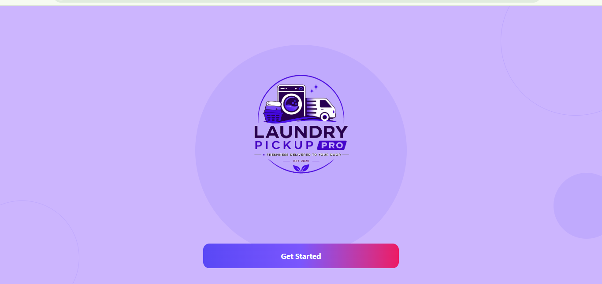
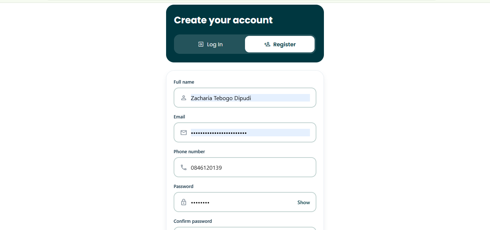
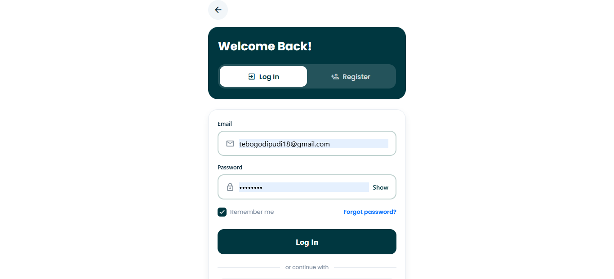
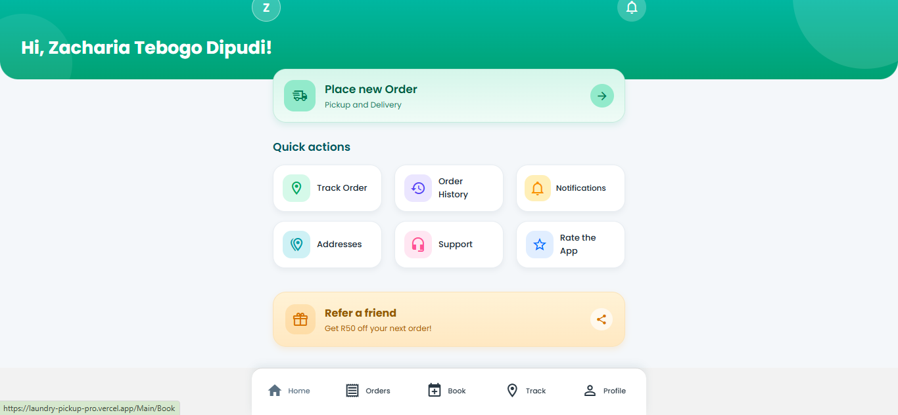
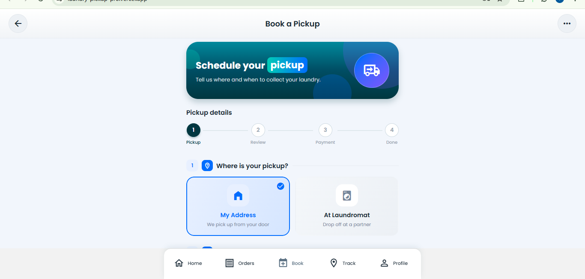
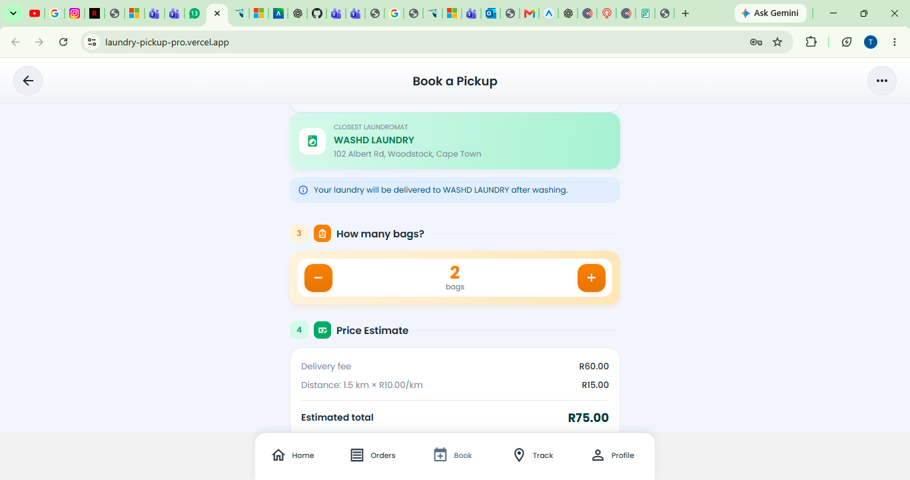
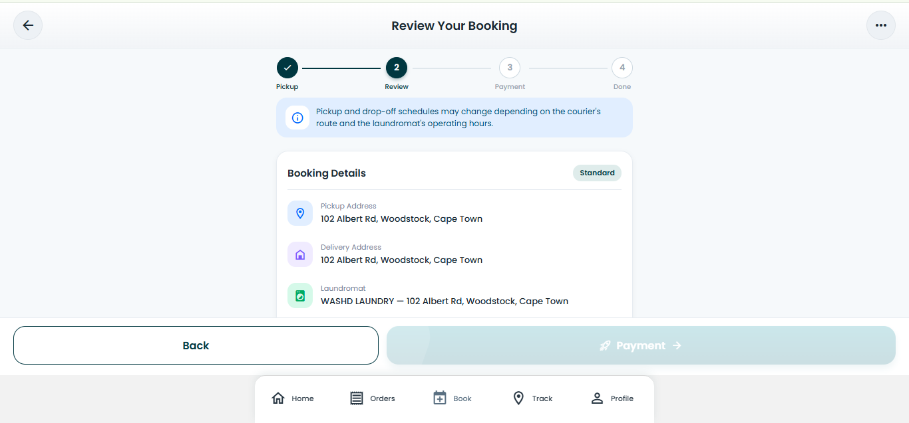
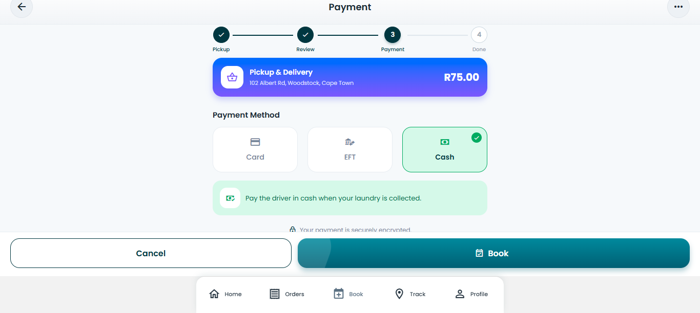
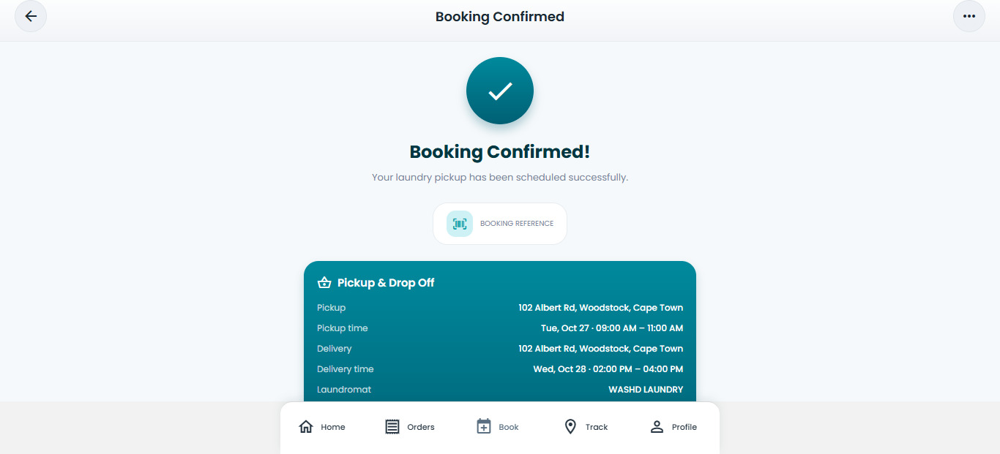

# User Stories and Tasks

## Project Overview

**Project:** Laundry Pickup Pro  
**Team:** Group 3D  
**My Role:** UI/UX Designer  
**Application:** Laundry pickup and delivery service

This section documents user stories and related tasks for Laundry Pickup Pro. The stories are based on the user journeys visible in the application screenshots, including registration, login, booking a laundry service, reviewing prices, choosing a payment method, and confirming a booking.

## 1. User Stories

### User Story 1: Welcome and Get Started

**As a** new user,  
**I want** to see a welcome screen with a clear option to get started,  
**So that** I can understand how to begin using the application.

**Tasks:**
- Design the welcome screen and application branding.
- Make the Get Started button easy to identify.
- Maintain a consistent visual style.

**Acceptance criteria:**
- The welcome screen displays the application branding.
- The user can identify the next step to enter the application.

**Evidence:** `evidence/01-welcome-screen.png`

### User Story 2: Select a User Role

**As a** person using the application,  
**I want** to select my user role,  
**So that** I can proceed using the appropriate account option.

**Tasks:**
- Design the role-selection screen.
- Present the Customer, Driver, and Administrator options clearly.
- Use clear labels and consistent card layouts.

**Acceptance criteria:**
- The available roles are clearly displayed.
- Each role can be distinguished from the others.

**Evidence:** `evidence/02-role-selection.png`

### User Story 3: Register and Log In

**As a** customer,  
**I want** to register an account and log in,  
**So that** I can access the application's customer features.

**Tasks:**
- Design the registration form.
- Arrange the personal information and password fields clearly.
- Design the login form and its available options.
- Provide visible labels and appropriate input controls.

**Acceptance criteria:**
- The registration screen displays the required input fields.
- The login screen provides email and password fields.
- The interface displays options such as password visibility and account registration.

**Evidence:**
- `evidence/03-registration-screen.png`
- `evidence/04-login-screen.png`

### User Story 4: View the Customer Dashboard

**As a** customer,  
**I want** to access a dashboard with the main service options,  
**So that** I can find the features I need easily.

**Tasks:**
- Design the customer dashboard layout.
- Organise the main actions and quick-access options.
- Use clear labels and a consistent navigation layout.

**Acceptance criteria:**
- The dashboard displays the main booking action.
- Quick-access options are presented clearly.
- Navigation options are visible to the customer.

**Evidence:** `evidence/05-customer-dashboard.png`

### User Story 5: Schedule a Laundry Pickup

**As a** customer,  
**I want** to choose my pickup arrangement,  
**So that** I can organise a laundry service that suits my needs.

**Tasks:**
- Design the pickup scheduling screen.
- Display the available pickup arrangement options.
- Present the booking progress steps clearly.

**Acceptance criteria:**
- The interface displays the available pickup options.
- The booking stages are identifiable.
- The customer can understand where they are in the booking process.

**Evidence:** `evidence/06-pickup-scheduling.png`

### User Story 6: Review the Estimated Price

**As a** customer,  
**I want** to see an estimated service price,  
**So that** I can understand the expected cost before continuing.

**Tasks:**
- Design the price-estimate screen.
- Display the selected laundromat and bag quantity.
- Present delivery and distance charges separately.
- Make the total price easy to identify.

**Acceptance criteria:**
- The interface displays the selected service information.
- The displayed charges are separated into understandable items.
- The estimated total is clearly visible.

**Evidence:** `evidence/07-price-estimate.png`

### User Story 7: Review the Booking and Choose Payment

**As a** customer,  
**I want** to review my booking details and choose a payment method,  
**So that** I can check the information before confirming my booking.

**Tasks:**
- Design the booking review screen.
- Organise pickup and delivery details.
- Display the price breakdown and total.
- Present the available payment methods clearly.

**Acceptance criteria:**
- The booking details are presented for review.
- The price breakdown and total are visible.
- The available payment options are clearly labelled.

**Evidence:**
- `evidence/08-booking-review.png`
- `evidence/09-payment-method.png`

### User Story 8: Receive Booking Confirmation

**As a** customer,  
**I want** to see a confirmation after completing the booking process,  
**So that** I can verify that a booking has been recorded by the application.

**Tasks:**
- Design a booking confirmation screen.
- Display the booking reference and relevant booking details.
- Use a clear confirmation message.

**Acceptance criteria:**
- The screen displays a booking confirmation message.
- The booking reference is visible.
- The pickup and delivery information is presented clearly.

**Evidence:** `evidence/10-booking-confirmation.png`

## 2. UI/UX Design Tasks

The following tasks describe the design areas represented in the screenshots. They should be updated to reflect the work personally completed during the project.

| Task | Purpose |
|---|---|
| Design the welcome screen | Introduce the application and guide new users. |
| Design the role-selection screen | Make the different account roles easy to identify. |
| Organise registration and login forms | Make account access information clear and readable. |
| Design the customer dashboard | Make important service options easy to find. |
| Design the pickup scheduling flow | Help customers understand the booking steps. |
| Present pricing information | Make charges and the total cost easy to understand. |
| Design the booking review and payment screens | Help customers review information before proceeding. |
| Design the confirmation screen | Present the booking reference and booking details clearly. |
| Review consistency across screens | Maintain consistent layouts, labels, spacing, and visual elements. |

## 3. Reflection

Creating user stories helped me understand the application from the customer's perspective. Each story describes a user need and explains why that need matters. The related tasks break the user journey into smaller design activities.

As the UI/UX Designer, my focus is on making the interface clear, consistent, and easy to navigate. The screenshots provide visual evidence of the screens available in the current application. They also help show how the interface guides a customer from the welcome screen through the booking process.

One area for further improvement is to review the interface with users and gather feedback about navigation, readability, and the clarity of booking information. The user stories and tasks can then be refined based on that feedback.

## 4. Evidence

The screenshots supporting these user stories are available in the [evidence folder](evidence/README.md).

# Laundry Pickup Pro — Portfolio Evidence

This folder contains visual evidence from the Laundry Pickup Pro application, developed to support the Agile project management e-portfolio for PRP372S.

The screenshots document the customer journey, from opening the application to completing a laundry pickup booking. Each item includes a description of the interface and its relevance to the project.

## Evidence Index

| Filename | Evidence | Assessment relevance |
|---|---|---|
| `01-welcome-screen.png` | Welcome screen and Get Started button | User Stories and Tasks; UI/UX design |
| `02-role-selection.png` | Customer, Driver, and Administrator options | User Stories and Tasks; user roles |
| `03-registration-screen.png` | Customer account registration | Product Backlog; account creation |
| `04-login-screen.png` | Customer login interface | Product Backlog; account access |
| `05-customer-dashboard.png` | Customer dashboard and quick actions | User Stories and Tasks; navigation |
| `06-pickup-scheduling.png` | Pickup location selection and booking steps | User Stories and Tasks; booking |
| `07-price-estimate.png` | Bag quantity and estimated price | Product Backlog; price transparency |
| `08-booking-review.png` | Booking details and price breakdown | User Stories and Tasks; review process |
| `09-payment-method.png` | Card, EFT, and cash options | Product Backlog; payment selection |
| `10-booking-confirmation.png` | Successful booking confirmation | User Stories and Tasks; user feedback |
| `11-order-tracking.png` | To be added after capturing the Track Order screen | Order tracking |

## Personal Contribution

My assigned role in the team charter was UI/UX Designer. These screenshots can help demonstrate my understanding of interface layout, navigation, visual hierarchy, and the customer booking journey.

The screenshots show the interfaces presented by the application. They do not independently prove which parts I personally implemented, how the team planned its sprints, or whether every feature works correctly.

## Reflection

Reviewing the application screens helps me understand how interface design supports a customer's journey. The booking process presents information in stages, allowing users to select pickup details, review the estimated cost, choose a payment method, and view a confirmation.

I learned the importance of clear navigation, understandable labels, visible costs, and feedback after a user action. I can use these observations to evaluate the design and identify areas for improvement. I will also connect this visual evidence to the relevant user stories and genuine project planning records in the rest of my portfolio.

## Privacy and Accuracy

Before publishing screenshots, remove or obscure personal email addresses, phone numbers, passwords, and private residential addresses. Only describe features as working when they have been tested.

## Visual Evidence from the Application

### 1. Welcome Screen

The welcome screen introduces Laundry Pickup Pro and provides a clear starting point for users.

### 2. User Role Selection

This screen allows users to choose between Customer, Driver, and Administrator.

### 3. Customer Registration

This screen provides a form for creating a customer account.

### 4. Customer Login

This screen provides access to existing customer accounts.

### 5. Customer Dashboard

The dashboard provides access to ordering, tracking, order history, notifications, and other customer actions.

### 6. Pickup Scheduling

Customers can select a pickup option and proceed through the booking stages.

### 7. Price Estimate

The booking interface displays the bag quantity and an estimated service cost.

### 8. Booking Review

Customers can review their booking details and the price breakdown before continuing.

### 9. Payment Method

The interface presents Card, EFT, and Cash as payment options.

### 10. Booking Confirmation

The confirmation screen displays the result of the booking process and summarises the arrangements.

